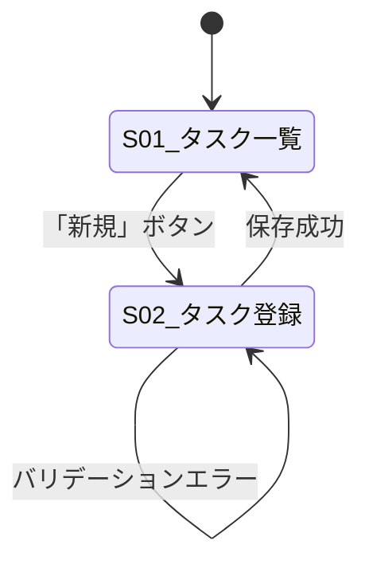
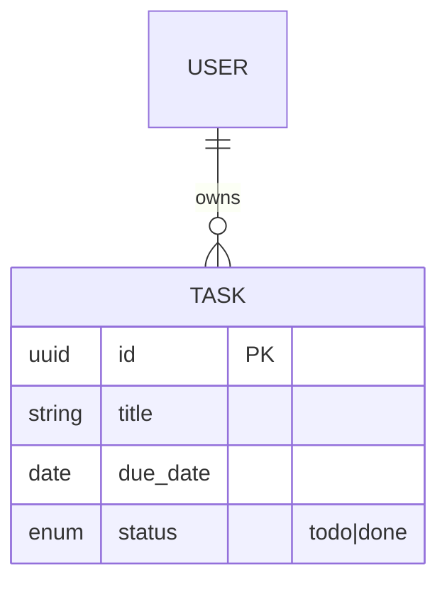

# 外部仕様資料のテンプレート

すべて `docs/dev-auto/<run-id>/spec/` に置く。ID は資料をまたいで共通に使う（機能 `F-01`、画面 `S-01`、エンティティ `E-01`、API `A-01`）。

## README.md（目次と合意状況）

~~~markdown
# 外部仕様: <タイトル>

- run: <run-id>
- 状態: 作成中 | 合意待ち | 合意済み（<日時>）
- 元の要件: <prd_path>
- 画面（UI あり時）: 対象デバイス <pc+phone | pc_only | fixed:WxH> / モックアップ <見た目まで合意 | ワイヤーフレーム> / 人による動作確認 <しない | する>

| 資料 | 状態 | 備考 |
|---|---|---|
| [機能一覧](features.md) | 新規作成 / 既存を参照（<パス>） / 対象外 |  |
| [画面遷移](screen-flow.md) | ... |  |
| [デザインシステム](design-system.md) | ... | 配色・文字・余白のトークン |
| [モックアップ](mockups/index.html) | ... | ブラウザで開く: `open docs/dev-auto/<run-id>/spec/mockups/index.html`（対象デバイスの幅で切り替え）。HTML 非対応画面: <画面 ID>（あれば） |
| [データモデル](data-model.md) | ... |  |
| [外部 IF](api.md) | ... |  |

## 合意の記録

- <日時> 第1版を提示
- <日時> 修正: <ユーザーの指摘の要約>
- <日時> 合意
~~~

## features.md（機能一覧）

~~~markdown
# 機能一覧

| ID | 機能名 | 概要 | 利用者 | 優先度 | 関連画面 | 区分 |
|---|---|---|---|---|---|---|
| F-01 | タスク登録 | タイトルと期限を入力してタスクを追加する | ログインユーザー | Must | S-02 | 新規 |

## F-01 タスク登録

- 振る舞い: <入力 → 処理 → 結果>
- 受け入れ条件:
  - Given <前提> When <操作> Then <結果>
- エラー時: <バリデーション・失敗時の見え方>
- 対象外: <今回やらないこと>
~~~

区分は「新規 / 変更 / 既存（変更なし・参考）」のいずれか。既存システムへの改修では、変更のある機能だけでなく、影響を受ける既存機能も「既存」として載せる。

## screen-flow.md（画面一覧と画面遷移）

~~~markdown
# 画面一覧

| ID | 画面名 | URL / ルート | 概要 | 関連機能 | モックアップ | 区分 |
|---|---|---|---|---|---|---|
| S-01 | タスク一覧 | /tasks | 自分のタスクを期限順に表示 | F-02, F-03 | [S-01](mockups/S-01-task-list.html) | 新規 |

# 画面遷移図



# 画面ごとの要素

## S-01 タスク一覧
- 表示項目: <項目・並び順・空のときの表示>
- 操作: <ボタン / リンク → 遷移先 or 結果>
- 状態: 通常 / 空 / 読み込み中 / エラー
~~~

## mockups/（HTML モックアップ）

- 1画面1ファイル: `mockups/<screen-id>-<slug>.html`
- `mockups/index.html` は **`references/mockup-viewer.html` をコピーして作る**。書き換えるのは `TITLE` と `SCREENS` 配列（id / name / file / note）、`target_devices` が `pc+phone` 以外なら `DEVICES` も。既定では各画面を PC 幅（1280px）とスマホ幅（375px）で並べて表示し、「並べて表示 / PC / スマホ」を切り替えられる
- 対象デバイス（`target_devices`）に合わせてレイアウトを成立させる
  - `pc+phone`（既定）: **PC とスマホの両方でレイアウトを成立させる**。375px 幅で横スクロールが出ないこと、タップ対象は 44px 四方以上であること。`@media (min-width: 768px)` などで段組み・余白・ナビゲーションを切り替え、PC では横幅を持て余さないよう最大幅や多段組みを使う
  - `pc_only`: PC 幅 1280px でレイアウトを成立させる。スマホ幅の対応は不要。PC で横幅を持て余さないよう最大幅や多段組みを使う
  - `fixed:<WxH>`: 基準解像度 <W>×<H> の固定サイズのステージ（例: `<div class="stage">` に `width: <W>px; height: <H>px`）に画面を組み、ウィンドウの大きさに合わせて `transform: scale()` で縦横比を保って縮小表示する。ステージの外にはみ出さないこと
- `mockup_style` に合わせる
  - `designed`（既定）: 見た目まで合意する。下の配色・デザインの決まりに従う
  - `wireframe`: 要素・配置・文言・状態だけを合意する。画像・グラデーション・影・装飾を使わず、design-system.md の仮テーマ（グレースケール）と枠線で描く。各画面の上部に「ワイヤーフレーム：要素と配置の確認用」と表示する
- HTML で要素と配置を表せない画面（canvas・3D・リアルタイム描画、チャートや地図の中身など）は、その部分を枠と注記（「描画領域: <何を表示するか>」）で示し、参照画像・要素の一覧・パラメータ表を screen-flow.md の画面の節に書く（下の「HTML 非対応画面」）
- 配色・文字・余白・角丸は `design-system.md` の CSS 変数を各ファイルの `:root` にそのまま書いて使う（色コードを直接書かない）
- **1ファイルで完結する静的 HTML**（CSS は `<style>` に書く。外部 CDN・JS フレームワーク・画像ファイルに依存しない）。ダブルクリックで開けること
- 画面間のボタン・リンクは実際に遷移先のモックアップへ `href` でつなぎ、クリックで画面遷移を体験できるようにする
- 実データ風のダミーデータを入れる（「テキスト」「xxx」だけにしない）。空状態やエラー表示がある画面は、同じファイル内に「状態切り替え」のタブかセクションで並べる
- 既存アプリの改修なら、既存の配色・フォント・レイアウト・コンポーネントの見た目に合わせる（既存の CSS 変数やデザイントークンを読んで写す）。新規なら素直で読みやすいデザインにし、装飾に凝りすぎない（`wireframe` では装飾を使わない）
- 画面の右上か下部に、小さく `S-01 タスク一覧 | 関連: F-02, F-03` のような注記を入れる
- `<meta name="viewport" content="width=device-width, initial-scale=1">` を入れる

### HTML 非対応画面（screen-flow.md の画面の節に書く）

~~~markdown
## S-03 <画面名>（HTML 非対応画面）
- 参照画像: <パス or URL>（スケッチ・既存画面の撮影・似た画面のキャプチャ）
- 表示する要素:
  | 要素 | 位置 | 内容・状態 |
  |---|---|---|
- パラメータ:
  | 項目 | 値 | 単位・備考 |
  |---|---|---|
  | <寸法・速度・タイミング・色など> | | |
~~~

## design-system.md（デザインシステム。`ui: true` のとき）

見た目の決まりごとを CSS 変数として1か所にまとめる。モックアップも実装もこの変数を使う。

~~~markdown
# デザインシステム

- 方針: シンプル（中立色 + アクセント1色） | 既存アプリ準拠（<参照したファイル>） | ユーザー指定（<指定内容>） | 仮テーマ（グレースケール等）・見た目は合意対象外（`mockup_style: wireframe`）
- ダークモード: なし | あり（`prefers-color-scheme: dark`）

## トークン

```css
:root {
  /* 色 */
  --color-bg: #ffffff;
  --color-surface: #f6f7f9;
  --color-text: #1f2328;         /* 本文。背景とのコントラスト比 4.5:1 以上 */
  --color-text-muted: #57606a;   /* 補足文字。これも 4.5:1 以上 */
  --color-border: #d0d7de;
  --color-primary: #0969da;      /* メイン色（ボタン・リンク・選択状態） */
  --color-on-primary: #ffffff;
  --color-danger: #cf222e;
  /* 文字 */
  --font-family: system-ui, -apple-system, "Hiragino Sans", "Noto Sans JP", sans-serif;
  --font-size-sm: 13px; --font-size-md: 15px; --font-size-lg: 20px;
  /* 余白・形 */
  --space-1: 4px; --space-2: 8px; --space-3: 12px; --space-4: 16px; --space-6: 24px;
  --radius: 8px;
  --tap-min: 44px;
  --content-max: 960px;
}
```

## ブレークポイント
- `pc+phone`: スマホ: 〜767px（1段組み） / PC: 768px〜（最大幅 `--content-max`、必要なら多段組み）
- `pc_only`: PC のみ（最大幅 `--content-max`）。スマホ幅は対象外
- `fixed:<WxH>`: ブレークポイントなし。基準解像度 <W>×<H> に組み、縦横比を保って拡大縮小する

## コントラスト確認
| 組み合わせ | 比 | 判定 |
|---|---|---|
| --color-text / --color-bg | 15.8:1 | AA ✔ |
~~~

- **文字色と背景色の組み合わせは、すべて WCAG AA（通常文字 4.5:1、大きい文字 3:1）を満たす**。値を決めたら比を計算して表に書く（例: `python3 -c` で相対輝度から計算する）
- 既存アプリの改修では、既存の CSS 変数・テーマ・Tailwind 設定などを読み取ってここに写す。新しく値を発明しない
- ブレークポイントは `target_devices` に当たる1行だけを書く
- `wireframe` のときは、色をグレースケール（背景・面・文字・枠線の濃淡）とアクセント1色程度の仮の値にし、方針に「見た目は合意対象外」と書く。実装でもこのトークンを使い、あとで値だけ差し替えられるようにする
- ブラウザ外で動く UI（`ui_runtime: native`）でも、トークンは同じ形で書く（モックアップが使う）。実装では、使う技術のテーマ・定数などに同じ名前と値で写す

## data-model.md（データモデル）

~~~markdown
# データモデル



## E-01 TASK
| 属性 | 型 | 必須 | 制約・既定値 | 説明 | 区分 |
|---|---|---|---|---|---|
| title | string(100) | ✔ | 空白不可 | タスク名 | 新規 |

- 状態遷移（あれば）: todo → done（完了操作）、done → todo（取り消し）
- 既存データへの影響・マイグレーション: <あれば>
~~~

既存のスキーマ（Prisma / SQL マイグレーション / ORM モデル / 型定義）がある場合は、そこから該当部分を読み取り、「既存」と「新規・変更」を区分列で分ける。

## api.md（外部インターフェース。該当時のみ）

外部から呼ばれる HTTP API・CLI コマンド・Webhook・イベント・公開関数など、利用者や他システムから見える入出力が変わる場合だけ作る。

~~~markdown
# 外部インターフェース

| ID | 種類 | 名前 / パス | 概要 | 区分 |
|---|---|---|---|---|
| A-01 | HTTP | POST /api/tasks | タスクを作成 | 新規 |

## A-01 POST /api/tasks
- リクエスト: <JSON 例>
- レスポンス: 201 <JSON 例> / 400 <エラー例>
- 認可: <誰が呼べるか>
~~~
